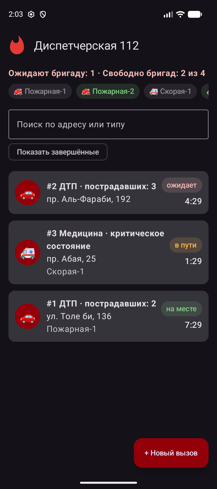
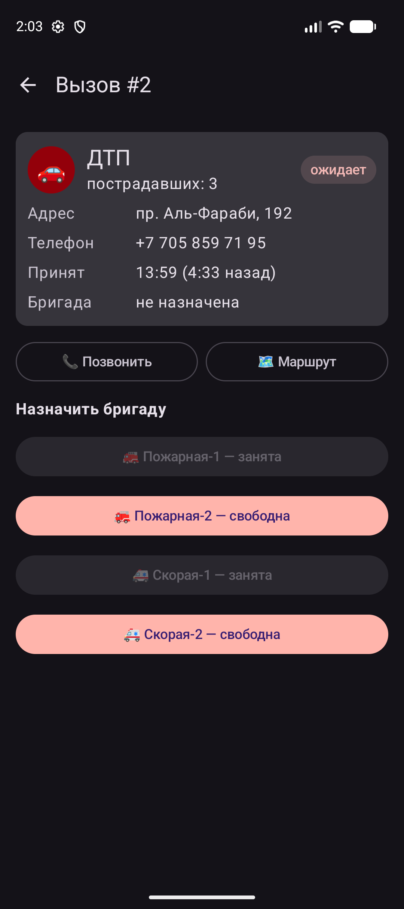
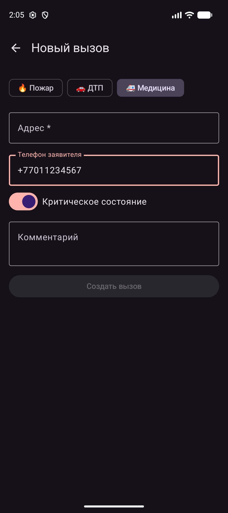

# Диспетчерская 112 (Android)

Рабочее место диспетчера службы 112 и экипажа выезда. Диспетчер видит очередь вызовов, сколько ждёт каждый вызов и какие бригады свободны, и назначает на вызов подходящую бригаду. Экипаж в карточке вызова звонит заявителю, строит маршрут и отмечает этапы: «в пути» → «на месте» → «завершён».

Проект продолжает HW1/HW2 (модели `Incident`, `Alarm`, `Vehicle`).

Стек: Kotlin, Jetpack Compose, Material 3, Navigation Compose, ViewModel + StateFlow, корутины.

## Функции

- **Очередь вызовов.** Сверху ожидающие бригаду, самые старые первыми, ниже вызовы в работе. У каждого вызова идёт таймер с момента поступления, обновляется каждую секунду. Есть поиск по адресу или типу и переключатель «Показать завершённые».
- **Сводка по бригадам.** Сколько вызовов ждёт и сколько бригад свободно. Свободные бригады подсвечены зелёным, занятые серым.
- **Назначение бригады.** В карточке вызова показаны только бригады, которые подходят по типу: пожарная не едет на медицинский вызов, скорая не едет на пожар. Занятые бригады нельзя выбрать.
- **Этапы выезда.** «Прибыли на место» → «Завершить вызов». После завершения бригада снова становится свободной.
- **Звонок и маршрут.** «Позвонить» открывает номеронабиратель с номером заявителя, «Маршрут» открывает адрес в картах.
- **Новый вызов.** Тип (пожар, ДТП, медицина), адрес (обязателен), телефон, детали (этаж, число пострадавших или критическое состояние), комментарий. После создания сразу открывается карточка вызова, чтобы назначить бригаду.

## Архитектура

```
app/src/main/java/kz/itspace/fire/
├── MainActivity.kt          - NavHost: маршруты calls, call/{id}, new
├── DispatchViewModel.kt     - состояние (StateFlow) и действия: addAlarm, assign, arrive, finish
├── model/Model.kt           - модели и чистая логика: queue(), busyUnits(), formatElapsed()
└── ui/
    ├── DispatchScreen.kt    - экран 1: очередь вызовов
    ├── CallScreen.kt        - экран 2: карточка вызова
    ├── NewCallScreen.kt     - экран 3: форма нового вызова
    ├── Components.kt        - переиспользуемые компоненты: AlarmCard, Pill, InfoLine, IncidentIcon, BackButton
    └── theme/Theme.kt       - тема Material 3 (светлая и тёмная)
```

- **Навигация.** Navigation Compose, три маршрута. В `call/{id}` передаётся аргумент `IntType`. После создания вызова форма убирается из стека (`popUpTo("calls")`), поэтому «Назад» из карточки ведёт к списку.
- **ViewModel.** Одна `DispatchViewModel` на Activity, общая для всех экранов. Список вызовов хранится в `MutableStateFlow` и наружу отдаётся как `StateFlow`. Изменения идут через `update {}` с неизменяемыми `copy()`.
- **Корутины.** `now` — это `flow { emit; delay(1000) }`, превращённый в `stateIn(viewModelScope, WhileSubscribed(5000))`. Таймер работает, только пока экран кто-то наблюдает.
- **Сбор состояния с учётом жизненного цикла.** Экраны читают `collectAsStateWithLifecycle()`, в фоне сбор останавливается.
- **Состояние UI.** `rememberSaveable` хранит поиск, фильтр и все поля формы, поэтому они переживают поворот экрана. `remember(alarms, query, showDone)` кэширует отфильтрованную очередь между ежесекундными перерисовками.
- **Подъём состояния (state hoisting).** Компоненты (`AlarmCard`, `Pill`, `InfoLine`) не хранят состояние: получают данные и колбэки. `NewCallScreen` ничего не знает о ViewModel и отдаёт результат через `onSave`.
- **Разделение слоёв.** UI в `ui/`, состояние и действия во ViewModel, правила (сортировка очереди, занятость бригад) в `model/` как чистые функции. Эти функции покрыты тестами в `app/src/test/.../ModelTest.kt`.
- **Смена конфигурации.** При повороте ViewModel сохраняет вызовы, NavHost сохраняет стек экранов, `rememberSaveable` сохраняет ввод.

## Запуск

1. Открыть папку проекта в Android Studio.
2. Дождаться Gradle Sync.
3. Выбрать эмулятор или устройство (Android 7.0+) и нажать **Run**.

Из терминала: `./gradlew installDebug`. Тесты: `./gradlew testDebugUnitTest`.

При запуске создаются 3 тестовых вызова, чтобы было с чем работать сразу.

## Скриншоты

| Очередь вызовов | Карточка вызова | Новый вызов |
|---|---|---|
|  |  |  |

1. Вызов #2 ждёт бригаду и стоит первым. #3 — бригада в пути, #1 — бригада на месте. Пожарная-1 и Скорая-1 заняты, это видно по серым плашкам.
2. Назначение бригады на ДТП: подходят и пожарные, и скорые, занятые недоступны.
3. Форма: выбран тип «Медицина», включено «Критическое состояние». Пока не заполнен адрес, кнопка «Создать вызов» неактивна.
