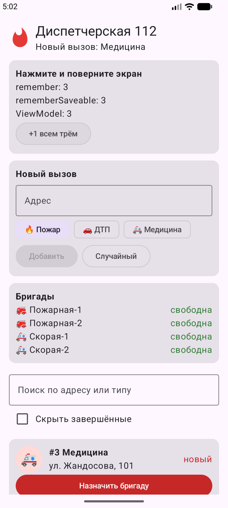
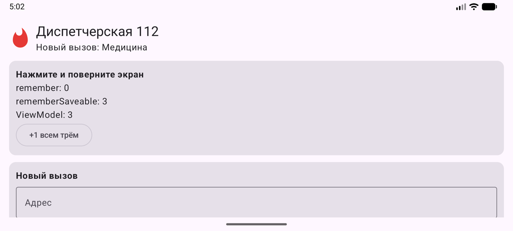

# Диспетчерская 112 (Android)

Android-версия консольного симулятора из HW1: пользователь играет роль диспетчера службы 112.
Он принимает вызовы (пожар, ДТП, медицина), назначает свободную бригаду и завершает вызовы.

Стек: Kotlin, Jetpack Compose, Material 3, ViewModel. Без сторонних библиотек.

## Функции

- **Список вызовов** (`LazyColumn` + `Card`): иконка типа, адрес, статус. Нажатие на карточку показывает детали.
- **Добавление вызова**: поле адреса (`OutlinedTextField`), выбор типа (`FilterChip`), кнопка «Добавить». Кнопка «Случайный» создаёт случайный вызов.
- **Обработка вызова**: «Назначить бригаду» выбирает свободную бригаду, которая подходит к типу вызова, затем «Завершить».
- **Поиск** по адресу или типу и **фильтр** «Скрыть завершённые» (`Checkbox`).
- **Бригады**: статус «свободна / занята» обновляется автоматически.
- **Демо поворота экрана**: три счётчика (`remember`, `rememberSaveable`, `ViewModel`) показывают, что сохраняется при пересоздании Activity.

## Структура

```
app/src/main/java/kz/itspace/fire/
├── MainActivity.kt        - точка входа, получает ViewModel
├── DispatchViewModel.kt   - состояние и логика экрана
├── model/Model.kt         - модели из HW1: Incident, Alarm, CallStatus, Vehicle, FireTruck, Ambulance, EntityRandomizer
└── ui/
    ├── DispatchScreen.kt  - экран и форма нового вызова
    ├── Components.kt      - компоненты: IncidentIcon, AlarmCard, UnitRow, CounterDemoCard
    └── theme/Theme.kt     - тема Material 3
```

## Запуск

1. Открыть папку проекта в Android Studio.
2. Дождаться Gradle Sync.
3. Выбрать эмулятор или устройство (Android 7.0+) и нажать **Run**.

Или из терминала: `./gradlew installDebug`

## Скриншоты

| Список вызовов | До поворота | После поворота |
|---|---|---|
|  |  |  |

1. Вызовы в разных статусах. У вызова #2 назначена «Скорая-2», в блоке «Бригады» она «занята».
2. Три счётчика после трёх нажатий.
3. После поворота: `remember` сбросился в 0, `rememberSaveable` и `ViewModel` сохранили 3.
